  

  
  

Hi, I'm Alexandre. From Huelgoat, in the heart of Brittany's Monts d'Arrée, I build **websites** and **custom software** for local non-profits, public bodies and businesses.

What drives me: simple, fast and accessible tools, built without relying on Big Tech whenever possible.

  

###  Currently building

- **[Vigie Bot](https://vigiebot.kouzia.com)** — a free Discord bot for streamers: Twitch & YouTube live alerts, clips, schedule, moderation and temporary voice channels
- **[CapsuleOS](https://os.lacapsule.org)** — try out desktop environments in your browser, learn them by playing and find the one that suits you ([source](https://github.com/k0uzia/CapsuleOS))
- **[Tracebay](https://tracebay.kouzia.com)** — IT hardware traceability software, used daily by La Capsule in Morlaix
- **[GoBox](https://demo-gobox.kouzia.com)** — a Go diagnostic tool for their computer refurbishing workshop

###  On the web

[ESS29](https://ess29.org) · [La Capsule](https://lacapsule.org) · [Morlaix Communauté](https://moco.lacapsule.org) · [ULAMIR CPIE](https://ulamir.lacapsule.org) · [SSA Pays de Morlaix](https://ssapaysdemorlaix.fr)

###  Side projects

- **[KouziaConverter](https://github.com/k0uzia/KouziaConverter)** — convert videos, images and icons locally, without uploading anything
- **[Safenet](https://github.com/k0uzia/Safenet)** — a fake "hacker" terminal for cybersecurity awareness escape games aimed at young people

---

  
  <b>Got a project in mind?</b> Reach me at <a href="mailto:contact@kouzia.com">contact@kouzia.com</a> or visit <a href="https://kouzia.com">kouzia.com</a>

