  

  
  
  

Salut 👋 Moi c'est Alexandre. Depuis Huelgoat, au cœur des monts d'Arrée, je fabrique des **sites web** et des **logiciels sur mesure** pour les associations, collectivités et entreprises du coin.

Ce qui m'anime : des outils simples, rapides et accessibles, sans dépendre des géants du numérique quand on peut l'éviter. 🌲

  

### 🛠️ En ce moment

- **[Tracebay](https://tracebay.kouzia.com)** — logiciel de traçabilité du matériel informatique, utilisé au quotidien par La Capsule à Morlaix
- **[GoBox](https://demo-gobox.kouzia.com)** — outil de diagnostic en Go pour leur atelier de reconditionnement

### 🌐 Sur le web

[ESS29](https://ess29.org) · [La Capsule](https://lacapsule.org) · [CapsuleOS](https://os.lacapsule.org) · [Morlaix Communauté](https://moco.lacapsule.org) · [ULAMIR CPIE](https://ulamir.lacapsule.org) · [SSA Pays de Morlaix](https://ssapaysdemorlaix.fr)

### 🧪 Side projects

- **[PterodactylCustom](https://github.com/k0uzia/PterodactylCustom)** — une CLI pour monter Pterodactyl, Wings, Cloudflare Tunnel et playit en quelques minutes
- **[KouziaConverter](https://github.com/k0uzia/KouziaConverter)** — convertir vidéos, images et icônes en local, sans rien envoyer sur Internet
- **[Safenet](https://github.com/k0uzia/Safenet)** — un faux terminal de « hacker » pour sensibiliser les jeunes à la cybersécurité en escape game

---

  <b>Un projet en tête ?</b> Écris-moi sur <a href="mailto:contact@kouzia.com">contact@kouzia.com</a> ou passe sur <a href="https://kouzia.com">kouzia.com</a> ☕

